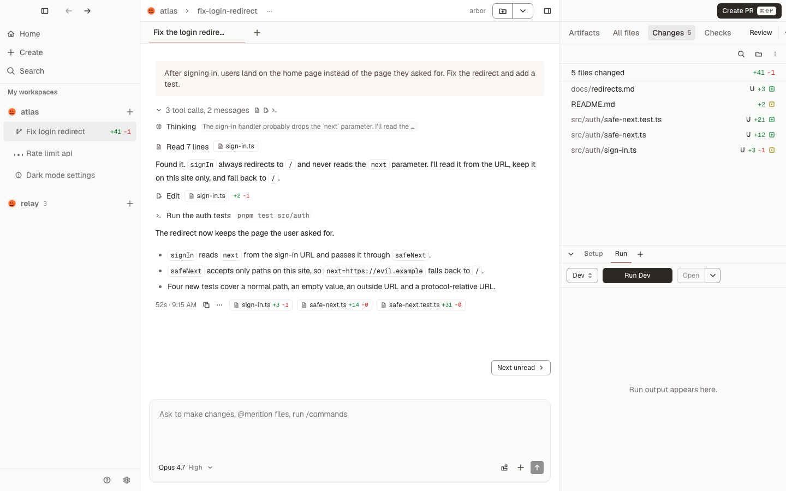

# Conducted

[](https://github.com/jahala/conducted/actions/workflows/ci.yml)

**Run a team of coding agents on your Mac.** Conducted gives every task its own git worktree and branch, its own chats with an agent, and one path from the first diff to a merged pull request.

It drives the agents you already use: Claude Code, Codex, Cursor, OpenCode and Pi. They run on your machine, with your own subscriptions and keys. Conducted adds the workspace around them: isolation, review, a snapshot of every turn, and the git and GitHub work that follows.

<picture>
  <source srcset="docs/site/images/chat-tool-calls-dark.png" media="(prefers-color-scheme: dark)">
  
</picture>

Conducted is an independent, open-source rebuild of [Conductor](https://conductor.build). It is not affiliated with Conductor or its makers. See [How it relates to Conductor](#how-it-relates-to-conductor).

## How a task flows

1. **Create a workspace.** Pick a repository and describe the task, or start from a branch, a pull request or an issue. Conducted makes a worktree on a new branch, copies your `.env` files, runs your setup script and reserves a port.
2. **Work with the agent.** Chat with any of the five agents. While it works, queue the next message or steer it mid-turn. Answer its questions and approve its plan from cards in the chat. Every turn is saved as a snapshot, so you can revert any turn, or fork the chat from it.
3. **Review the change.** Read the diff by branch, by commit or by turn. Leave comments on lines, and send them to the agent to fix. Run your dev server or tests in the workspace, and open a preview in the app.
4. **Ship it.** Create the pull request, watch its checks, send failing checks back to the agent, and merge, all from the same panel. Archiving the workspace removes the worktree and keeps its history.

## Features

| Area           | What you get                                                                                                                                                                   |
| -------------- | ------------------------------------------------------------------------------------------------------------------------------------------------------------------------------ |
| Workspaces     | One worktree and branch per task, setup and archive scripts, a port each, linked folders, a sidebar grouped by status or project, sections and pins                            |
| Chats          | Several chats per workspace as tabs and split panes, any agent and model per chat, queue and steer, questions and plan approval, a progress tracker, context and cost per turn |
| Remote Control | Open any Claude chat in claude.ai/code or the Claude app to follow it, send follow-ups and answer approvals while it runs on your Mac                                          |
| Snapshots      | A hidden git ref before and after every turn: revert to a turn, fork a chat, see what each turn changed                                                                        |
| Review         | Changed files by scope, a split or unified diff, review comments for the agent, file tree, quick open, search in files, an editor and previews                                 |
| Git and GitHub | Commit, push and pull; create, check, fix and merge pull requests; stacked PRs; Linear and GitHub issues as context                                                            |
| Run and test   | Run scripts per workspace, terminals, port detection, an in-app browser preview, and Spotlight to try changes in your main checkout                                            |
| The rest       | A command palette, keyboard shortcuts for everything, notifications, dictation, and settings per user and per repository                                                       |

What it does not do:

- It does not include an agent. It drives the agent programs you install, or downloads their official releases for you.
- It does not need an account or a server. Everything runs on your Mac.
- It does not send your code anywhere except to the agent you chose.

## Install

### Homebrew

```bash
brew install --cask jahala/tap/conducted
```

Each release updates the cask with the published `.dmg` and its checksum. The app updates itself when a new release is out.

### Download

Signed and notarised builds are published on the [releases page](https://github.com/jahala/conducted/releases/latest). Download the `.dmg`, open it and drag Conducted to Applications. The app updates itself when a new release is out. If the latest release has no `.dmg` yet, build from source.

### Build from source

You need [Rust](https://rustup.rs), [Node.js](https://nodejs.org), [pnpm](https://pnpm.io) and [Bun](https://bun.sh). Their versions are pinned in `.node-version`, `.bun-version`, `package.json` and `apps/desktop/src-tauri/rust-toolchain.toml`.

```bash
git clone https://github.com/jahala/conducted
cd conducted
pnpm install
pnpm dev      # builds the sidecar and opens the app
```

## Requirements

- **A Mac with Apple silicon.** Release builds are made for Apple silicon only.
- **An account for at least one agent.** A Claude subscription, an Anthropic API key or Amazon Bedrock for Claude Code; a ChatGPT plan or an OpenAI API key for Codex; or the keys that Cursor, OpenCode or Pi use. You sign in from the app's Agents settings.
- **GitHub, for pull requests.** Your own `gh` sign-in, or a personal access token entered in the app. Conducted installs `gh` for you.

## How it relates to Conductor

Conducted rebuilds the local features of [Conductor](https://conductor.build), a commercial app for running coding agents in parallel. The screens and actions follow Conductor's ([decision D020](docs/decisions.md)). Team features are left out. Cloud workspaces are being built to run on your own Cloudflare account, with no hosted service ([docs/plans/cloud-and-remote.md](docs/plans/cloud-and-remote.md)). The behaviour is written down in [docs/research/conductor/](docs/research/conductor/structure-map.md) and rebuilt from that description. Conducted's code, text and images are its own; nothing is copied from Conductor ([decision D002](docs/decisions.md)).

Conducted is not affiliated with, endorsed by or connected to Conductor or its makers.

## Documentation

- [Architecture](docs/architecture.md): the parts of the app, what each may depend on, and where each kind of logic lives.
- [Engineering](docs/engineering.md): how the code is written, tested and released.
- [Decisions](docs/decisions.md): every product and build decision, dated, with its reasons.
- [Design](docs/design.md): the design tokens and the rules every screen follows.
- [Data model](docs/data-model.md): the tables and files, and how long each keeps its data.
- [Changelog](CHANGELOG.md): every release, newest first.

## Contributing

Every feature has an id in the [backlog](docs/plans/backlog.md), and the files that own it name it in their header. Start with [CONTRIBUTING.md](CONTRIBUTING.md). Report a security problem as [SECURITY.md](SECURITY.md) describes, and follow the [code of conduct](CODE_OF_CONDUCT.md).

## Support

[](https://buymeacoffee.com/jahala)

## License

[MIT](LICENSE)
